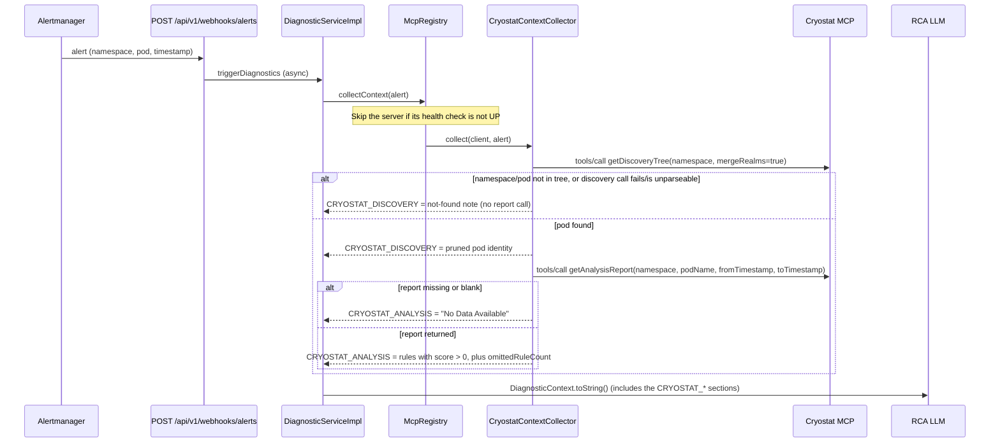

# Cryostat Integration

Causa collects automated JFR analysis from [Cryostat](https://github.com/cryostatio/cryostat) during cluster root-cause analysis. This document describes how that integration works, how the data is used, and how to test the path. For MCP server tunables and workload label setup, see also [MCP Tunables](../tunables/mcp.md).

## Overview

Causa does not call Cryostat's REST or GraphQL APIs, and it does not start, download, or parse raw JFR files. On the cluster diagnostic path it talks only to the [Cryostat MCP server](https://github.com/cryostatio/cryostat-mcp) over MCP (`streamable-http`, JSON-RPC 2.0 + SSE). After an alert is accepted, `CryostatContextCollector` first calls `getDiscoveryTree`; only if the alert's namespace and pod appear in that tree does it call `getAnalysisReport` for archived recordings in a lookback window ending at the alert time. The compacted report (rules with `score > 0`) is added to the diagnostic context and passed to the RCA LLM.

## Architecture

Causa is wired to Cryostat only in the **cluster** MCP profile (`mcp-cluster-default.json`). The developer and VM profiles do not declare a `cryostat` server. Causa does not ship Cryostat, the Cryostat operator, or the MCP server; it expects a Service already running and uses the URL in `mcp.json`. The default Service name in that file is `cryostat-mcp-cryostat-k8s-multi-mcp` (HTTP, port 8080). There is no Cryostat-specific auth or TLS configuration in Causa: `headers` is empty, and `McpClient` uses the JDK `HttpClient` against `http://` URLs.



## Configuration

The live settings are in `mcp.json`, loaded at startup by `McpSettingsLoader` from `causa.mcp.config-file` (`MCP_CONFIG_FILE`). In a cluster deploy, kustomize generates ConfigMap `causa-mcp-config` from `deployment/kubernetes/base/mcp-config/mcp-cluster-default.json` and mounts it at `/etc/causa/mcp.json` (prod default path). Changing Cryostat's URL means editing that JSON (or the mounted file) and restarting Causa; the `CAUSA_MCP_CRYOSTAT_*` environment variables do **not** drive this collector.

| Setting | Where | Value in current cluster JSON | Meaning |
|---|---|---|---|
| Config file path | env `MCP_CONFIG_FILE` / `causa.mcp.config-file` | `/etc/causa/mcp.json` (prod); `deployment/kubernetes/base/mcp-config/mcp-cluster-default.json` (dev/`test` profiles in `application.yml`) | File loaded at startup |
| Server key | `mcpServers.cryostat` | `cryostat` | Name `McpRegistry` switches on |
| Transport | `type` | `streamable-http` | MCP over HTTP + SSE |
| MCP URL | `url` | `http://cryostat-mcp-cryostat-k8s-multi-mcp:8080/mcp` | JSON-RPC endpoint |
| Extra headers | `headers` | `{}` | No Cryostat token/auth is set by Causa |
| Optional | `optional` | `true` | Cryostat being down does not fail overall health |
| Health URL | `healthCheck.url` | `http://cryostat-mcp-cryostat-k8s-multi-mcp:8080/q/health/ready` | `GET`; 2xx = UP |
| Health timeout | `healthCheck.timeoutMs` | `15000` | Milliseconds |
| Tool-call timeout | `timeoutMs` | `60000` | Milliseconds (reports can be slow) |
| Lookback | `metadata.analysisLookbackMinutes` | `15` | Minutes before `toTimestamp`; values ≤ 0 fall back to 15 |
| Discovery tool | `tools[]` `getDiscoveryTree` | args: `namespace=${namespace}`, `mergeRealms=true` | Context key `CRYOSTAT_DISCOVERY` |
| Report tool | `tools[]` `getAnalysisReport` | args: `namespace`, `podName`, `fromTimestamp`, `toTimestamp` | Context key `CRYOSTAT_ANALYSIS` |

`fromTimestamp` / `toTimestamp` are not in the JSON as literals; `CryostatContextCollector` computes them and `McpRegistry.resolveArguments` substitutes the `${…}` placeholders. `toTimestamp` is the alert timestamp, or `Instant.now()` if the alert has none. `fromTimestamp` is that instant minus the lookback.

`application.yml` and `deployment/kubernetes/base/configmap.yaml` still bind `CAUSA_MCP_CRYOSTAT_ENDPOINT` (default `http://cryostat-mcp:8000`), `CAUSA_MCP_CRYOSTAT_HEALTH_ENDPOINT` (`http://cryostat-mcp-api:8080`), `CAUSA_MCP_CRYOSTAT_HEALTH_PATH` (`/healthz`), `CAUSA_MCP_CRYOSTAT_TIMEOUT` (`15000`), `CAUSA_MCP_CRYOSTAT_RETRY_DELAY`, and `CAUSA_MCP_CRYOSTAT_MAX_RETRIES`. `McpConfig.CryostatConfig` exists so those properties still bind; no Java caller reads `mcpConfig.cryostat()`, and the collector does not use the retry settings. Those unused defaults also differ from the URLs in `mcp-cluster-default.json`. Use the cluster JSON for the live values.

Causa documentation states that both MCP tools are exposed when the already-deployed cryostat-mcp `toolLevel` is `ALL` (described as that chart's default). That setting lives on the MCP server, not in this repository.

## Step-by-step data flow

1. **Alert in.** `POST /api/v1/webhooks/alerts` accepts a Prometheus Alertmanager payload. Accepted alerts call `DiagnosticServiceImpl.triggerDiagnostics`, which returns a `diag_…` id immediately and runs MCP collection plus RCA on a background thread.
2. **Health gate.** `McpRegistry.collectFromServer` calls `McpClient.checkHealth()` for the `cryostat` entry. If the status is not `UP`, Cryostat is skipped and no `CRYOSTAT_*` keys are written.
3. **Discovery.** `CryostatContextCollector.collect` resolves `getDiscoveryTree` arguments and calls the tool. It walks the tree looking for a `Namespace` node matching the alert namespace, then a `Pod` whose `name` (or target `alias` / Cryostat `HOST` annotation) matches the alert pod. On a match it stores a pruned identity: `namespace`, `deployment`, `replicaSet`, `pod`, and when present `jvmId`, `alias`, `javaMain`.
4. **Report (only after a match).** It calls `getAnalysisReport` with the namespace, pod name, and ISO-8601 window described above. Causa does not start a recording. The MCP tool is documented in `mcp.json` as analysing **archived** JFR recordings that intersect that window.
5. **Compaction.** `compactReport` keeps rules whose numeric `score` is greater than 0, highest score first, and counts the rest as `omittedRuleCount`. Each kept rule is flattened to `id`, `name`, `topic`, `score`, plus `summary` / `explanation` / `solution` / `suggestions` taken from the rule's `evaluation` object. A blank or failed report is stored as `No Data Available`. A discovery miss, a failed discovery call, or unparseable JSON all store the same not-found note and **do not** call the report tool.
6. **Into the RCA.** `DiagnosticContext.toString()` dumps every `contextData` entry, including `CRYOSTAT_DISCOVERY` and `CRYOSTAT_ANALYSIS`, into the LLM prompt. The RCA template (`src/main/resources/prompts/rca-prompt-template.yml`) tells the model how to read those sections. The full formatted context is also written to Causa's log (look for the context dump around diagnostic collection). The diagnostic detail API returns the RCA (`evidences`, `llm_notes`, and so on); it does not return the raw MCP context blob.

## How Cryostat data is used

Causa never inspects individual JFR event types itself. The MCP server's analysis rules are the unit of data. The RCA prompt maps rule **topics** as:

| Topic in `CRYOSTAT_ANALYSIS` | How the RCA prompt / skills treat it |
|---|---|
| `garbage_collection` | GC pauses / GC overhead (`POSSIBLE_GC_PAUSE`); corroborate with metrics such as `gcPauseTimeMs` or `jvm_gc_overhead` |
| `heap` | Memory pressure / OOM precursor; corroborate with pod events such as `OOMKilling` |
| `lock_instances` | Threads and locks / contention |
| `exceptions` | Exception pressure |

The prompt also says a score of `-1` means the required JFR event was not enabled in the recording, and `0` means no problem; both are already omitted before the LLM sees the report. Higher scores are treated as more severe.

The test fixture `src/test/resources/cryostat/getAnalysisReport.json` (the shape the collector expects) also contains other topics with `score > 0` in that sample — for example `jvm_information`, `java_application`, `socket_io`, `vm_operations`, `memoryleak`, `method_profiling`, and `processes`. Those are not named in the prompt's topic map. The model is still instructed to use each rule's score, topic, summary, explanation, and solution.

Downstream:

- **RCA LLM (primary use):** the prompt and skills (`quarkus-diagnostics`, `async-profiler-diagnostics`, `kruize-optimization`) cite `CRYOSTAT_ANALYSIS` rule id, topic, and score as evidence.
- **Evidence mapping:** Path A and Path B can typemap a `CRYOSTAT_ANALYSIS` evidence or signal to `EvidenceItem.EvidenceType.JVM_ANALYSIS`. `McpSourceResolver` attributes a section to server `cryostat` from the tool `contextKey`s in `mcp.json`.
- **Rules engine:** `Signal.SignalType.CRYOSTAT_ANALYSIS` exists, but `DiagnosticContextSignalExtractor` does not extract Cryostat signals, and the shipped rulesets (`gc-pause.yml`, `oom-killed.yml`) do not use `signalType: CRYOSTAT_ANALYSIS`. Path B rule evaluation does not currently consume the Cryostat report directly.

## Where it is in the code

| Piece | Path |
|---|---|
| Collector | `src/main/java/com/causa/mcp/util/CryostatContextCollector.java` (`collect`, `findMatch`, `compactReport`, `lookbackMinutes`) |
| Registry switch | `src/main/java/com/causa/mcp/McpRegistry.java` (`collectFromServer` → `case "cryostat"`) |
| MCP HTTP client | `src/main/java/com/causa/mcp/McpClient.java` (`checkHealth`, `callTool`) |
| Startup / JSON load | `src/main/java/com/causa/mcp/McpStartup.java`, `src/main/java/com/causa/mcp/config/McpSettingsLoader.java`, `McpSettings.java` |
| Tool name constants | `src/main/java/com/causa/common/constants/McpConstants.Tools` (`getDiscoveryTree`, `getAnalysisReport`) |
| Cluster MCP profile | `deployment/kubernetes/base/mcp-config/mcp-cluster-default.json` |
| Kustomize mount | `deployment/kubernetes/base/kustomization.yaml`, `deployment.yaml` (`/etc/causa`) |
| RCA prompt | `src/main/resources/prompts/rca-prompt-template.yml` |
| Pipeline trigger | `WebhookController` → `DiagnosticServiceImpl.triggerDiagnostics` / `collectContext` |
| Unit tests + sample payloads | `src/test/java/com/causa/mcp/util/CryostatContextCollectorTest.java`, `src/test/resources/cryostat/getDiscoveryTree.json`, `getAnalysisReport.json` |
| Related docs | [MCP Tunables](../tunables/mcp.md), [Health Endpoint](../api/health-endpoint.md), [Diagnostics API](../api/diagnostics-api.md) |

## Testing the integration

### Prerequisites

- Causa running with the **cluster** MCP file (`mcp-cluster-default.json`), so a `cryostat` server is actually registered.
- Cryostat MCP reachable at the `url` / `healthCheck.url` in that file (or at whatever those values have been changed to). Overall Causa health will still be UP if Cryostat is down, because the server is optional — check the Cryostat entry explicitly.
- A Cryostat instance that has discovered the target workload. Put these labels on the **pod template**: `cryostat.io/name`, `cryostat.io/namespace`, `cryostat.io/harvester-template` (example: `Continuous`); optional `cryostat.io/harvester-period`, `cryostat.io/harvester-max-files`, `cryostat.io/log-level`. See the example and reference link in [MCP Tunables](../tunables/mcp.md).
- Archived recordings that cover the alert window. Causa will not start a recording if none exist.
- The cryostat-mcp `toolLevel` should be `ALL`, or the two tools may be missing. That setting is documented in this repository as a requirement on the MCP server.

Causa does not deploy Cryostat. Install Cryostat and cryostat-mcp separately, then point `mcp.json` at the MCP Service.

### Trigger the flow

1. Confirm Causa started MCP: the log line `MCP startup: completed successfully` should include `cryostat` in `serverNames`.
2. `GET /api/v1/healthz`. MCP health is one component named `mcp`, with a `servers` map. Look at `servers.cryostat` (`status` should be `UP`, message like `Connected successfully`). Because Cryostat is optional, a DOWN entry here does **not** fail overall health. ([Health Endpoint](../api/health-endpoint.md) still describes per-server `mcp_cryostat` components; that does not match `HealthCheckService`.)
3. Send an Alertmanager-style payload to `POST /api/v1/webhooks/alerts` whose firing alert has the **same namespace and pod name** as a discovered JVM, and a timestamp whose lookback window overlaps an archived recording.
4. The webhook returns a diagnostic id immediately. Poll `GET /api/v1/diagnostics/{id}` until status is completed (or failed).

### What to verify

- **Causa logs, context dump** after `CONTEXT_COLLECTED`: sections `CRYOSTAT_DISCOVERY` and `CRYOSTAT_ANALYSIS`. A successful match looks like JSON with `namespace`, `pod`, and usually `jvmId` / `alias` / `javaMain`. A successful report looks like JSON with `rules` (each `score > 0`) and `omittedRuleCount`.
- **RCA output** on `GET /api/v1/diagnostics/{id}`: `diagnosis.evidences` and `llm_notes` should mention Cryostat rule ids / topics / scores when analysis was present, or say that discovery/analysis was missing or `No Data Available` (the prompt asks the model to record that).
- **`hasCryostatContext` in logs is not a reliable signal** that this path ran. `DiagnosticContext.hasCryostatContext()` still checks the older typed fields (`gcAnalysis`, `memoryAnalysis`, and similar) that the collector no longer populates, so it can log `false` after a successful collection. Use the context dump or the RCA text instead.
- **Unit tests** (no cluster required):

```bash
./mvnw -Dtest=CryostatContextCollectorTest,McpContextCollectorTest,McpRegistryTest test
```

### Common failure modes

| What you see | Likely cause |
|---|---|
| No `CRYOSTAT_*` sections at all | `cryostat` missing from the active `mcp.json` (wrong profile); health check not UP (wrong URL/Service, MCP down); or the `getDiscoveryTree` tool is not in the server's `tools` list |
| `CRYOSTAT_DISCOVERY` = “Pod … was not found in the Cryostat discovery tree.” and no analysis section | Pod not registered (agent/labels/namespace not watched), **or** the discovery call failed / returned unparseable JSON (the collector uses the same note for all of these) |
| Discovery JSON present, `CRYOSTAT_ANALYSIS` = `No Data Available` | Report tool failed, returned blank, or no archived recording intersects the window. Confirm harvester/archives on the Cryostat side |
| Tools fail with MCP errors in logs (`MCP tool call failed`, `server=cryostat`) | URL/timeout, tools not exposed (`toolLevel` not `ALL`), or MCP/session errors |
| Changing `CAUSA_MCP_CRYOSTAT_ENDPOINT` has no effect | Expected — the collector reads `mcp.json` only |
| Overall `/healthz` is UP but Cryostat never runs | Expected when `optional: true` and `servers.cryostat` is DOWN |
